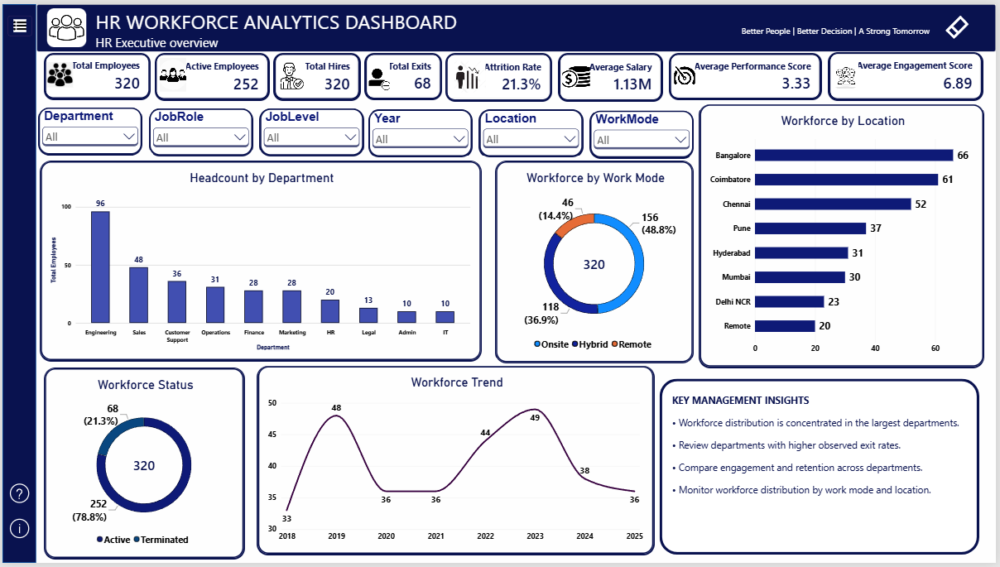
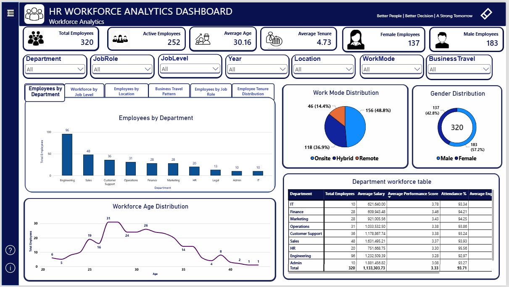
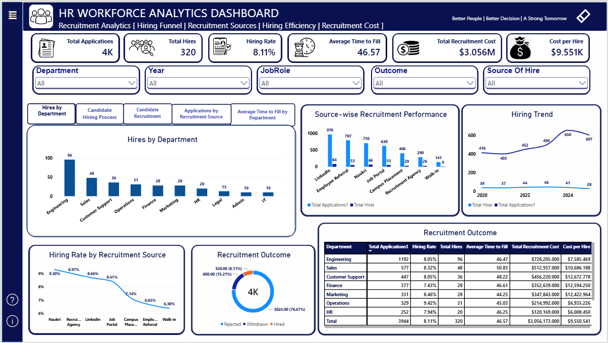
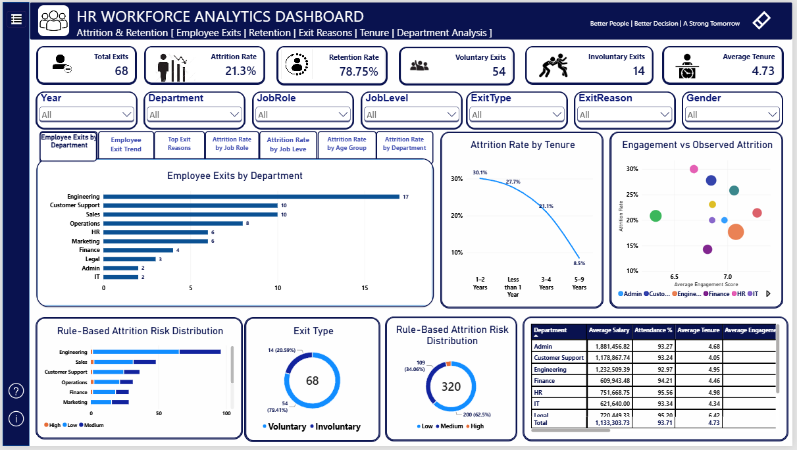
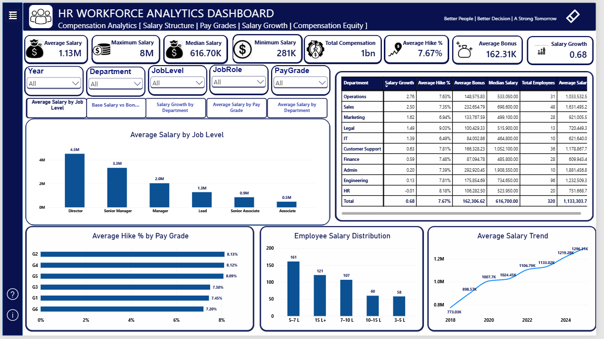
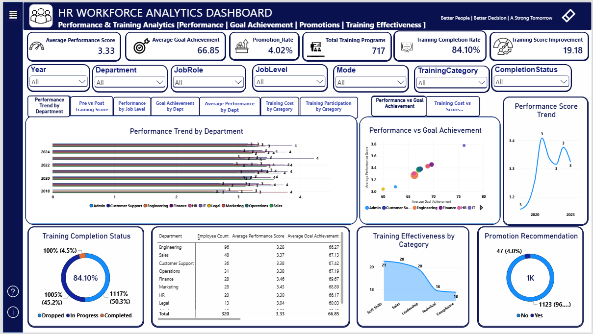
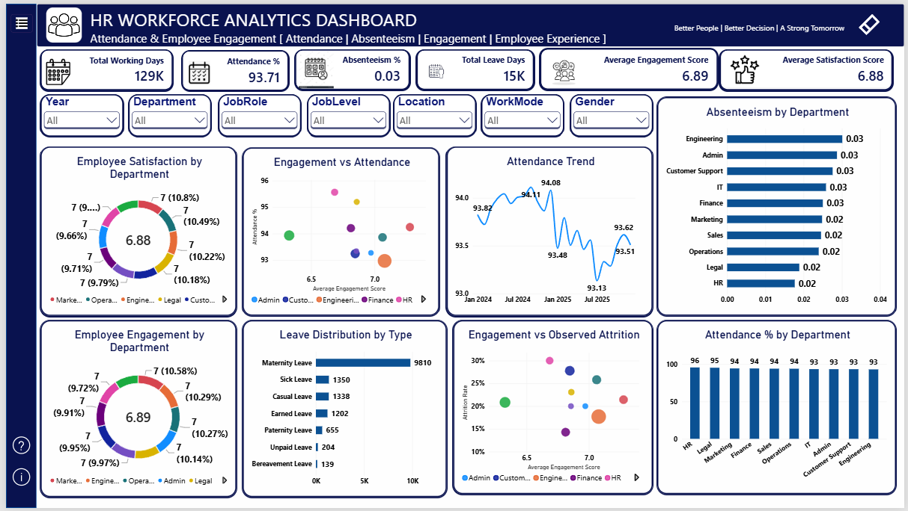
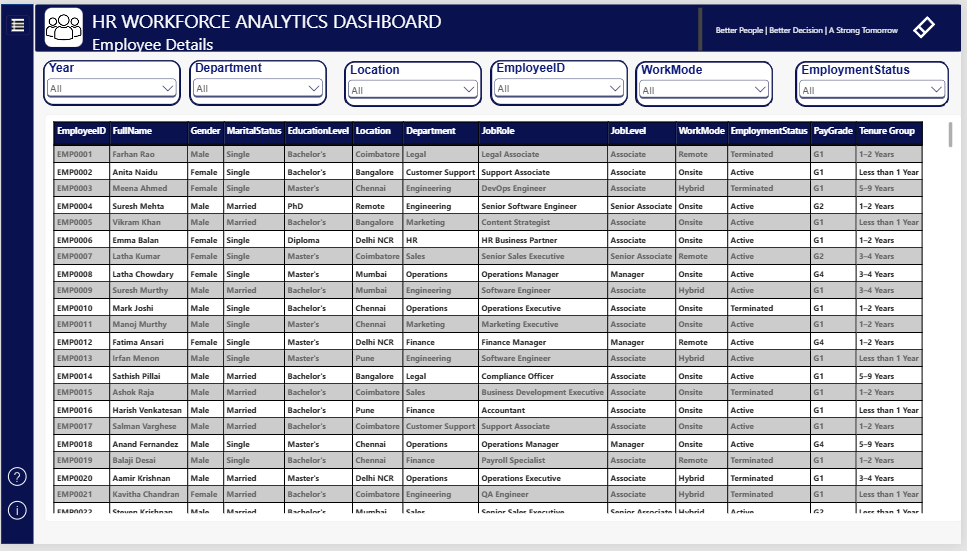
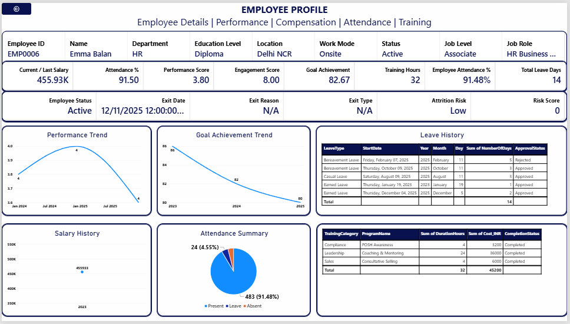

# 👥 HR Analytics & Workforce Intelligence Dashboard | Power BI

An end-to-end **HR Analytics & Workforce Intelligence Dashboard** developed using **Microsoft Power BI** to analyze workforce composition, recruitment, attrition, compensation, employee performance, training, attendance, engagement, and HR costs.

The project includes **Power Query** for data cleaning and transformation, **star-schema data modeling**, and **DAX** for analytical calculations and KPI development. It also features **interactive slicers, sidebar navigation, page navigation, multi-chart navigation, cross-filtering, tooltips, data validation, and employee-level drill-through profiles** to enable interactive and detailed workforce analysis across multiple report pages.

The dataset used for this project was **generated using Claude AI** for learning, portfolio development, and demonstration purposes.

---

# 📌 Project Objectives

The main objectives of this project are:

- Analyze workforce composition
- Monitor employee headcount and workforce trends
- Analyze recruitment performance
- Compare recruitment sources
- Analyze employee exits and observed attrition
- Monitor employee retention
- Analyze compensation and salary structures
- Evaluate employee performance
- Analyze goal achievement
- Analyze training participation and effectiveness
- Monitor attendance and absenteeism
- Analyze employee engagement and satisfaction
- Analyze HR costs and workforce efficiency
- Provide employee-level drill-through analysis
- Build an interactive HR analytics reporting solution

---

# 📁 Repository Structure

```text
HR-Analytics-PowerBI/
│
├── HR Analytics Dashboard.pbix
├── HR_Analytics_Dataset.xlsx
├── Dashboard Screenshots/
│   ├── Page 1 - HR Executive Overview.png
│   ├── Page 2 - Workforce Analytics.png
│   ├── Page 3 - Recruitment Analytics.png
│   ├── Page 4 - Attrition & Retention.png
│   ├── Page 5 - Compensation Analytics.png
│   ├── Page 6 - Performance & Training Analytics.png
│   ├── Page 7 - Attendance & Employee Engagement.png
│   ├── Page 8 - HR Cost & Workforce Efficiency.png
│   ├── Page 9 - Employee Details.png
│   └── Page 10 - Employee Profile.png
│
└── README.md
```

## 📄 Repository Files

| File / Folder | Description |
|---|---|
| `HR Analytics Dashboard.pbix` | Power BI dashboard file |
| `HR_Analytics_Dataset.xlsx` | Source HR analytics dataset |
| `Screenshots/` | Screenshots of all dashboard pages |
| `README.md` | Project documentation |

---

# 🖼️ Dashboard Preview

## Page 1 — HR Executive Overview

Provides a high-level summary of the organization's workforce and key HR performance indicators.



## Page 2 — Workforce Analytics

Provides a detailed analysis of workforce composition, employee demographics, organizational structure, work modes, and employee distribution.



## Page 3 — Recruitment Analytics

Provides an overview of recruitment performance, hiring activity, recruitment sources, hiring efficiency, and recruitment costs.



## Page 4 — Attrition & Retention

Analyzes employee exits, retention, observed attrition patterns, exit types, tenure, and department-level attrition.



## Page 5 — Compensation Analytics

Analyzes salary structure, pay grades, bonuses, salary growth, salary distribution, and compensation differences across departments and job levels.




## Page 6 — Performance & Training Analytics

Analyzes employee performance, goal achievement, promotion recommendations, training participation, completion, cost, and training effectiveness.



## Page 7 — Attendance & Employee Engagement

Analyzes employee attendance, absenteeism, leave patterns, employee engagement, satisfaction, and relationships between attendance and engagement.



## Page 8 — HR Cost & Workforce Efficiency

Provides an overview of HR spending, workforce costs, recruitment investment, training investment, compensation costs, and department-level HR efficiency.


## Page 9 — Employee Details

Provides an employee-level workforce table containing demographic, organizational, employment, and job-related information.



This page acts as the starting point for employee-level drill-through analysis.

## Page 10 — Employee Profile

Provides a detailed individual employee profile using **Power BI Drill-through functionality**.



### 🔄 Drill-through Flow

```text
Employee Details
       ↓
Select Employee
       ↓
Right Click
       ↓
Drill Through
       ↓
Employee Profile
       ↓
Detailed Employee Analysis
```

---

# 🧰 Tools & Techniques Used

## 🛠️ Tools

- **Microsoft Power BI**
- **Power Query**
- **DAX**
- **Microsoft Excel**
- **GitHub**

## 🧹 Data Preparation & Transformation

The project uses Power Query for:

- Data Import
- Data Cleaning
- Data Transformation
- Data Type Conversion
- Missing Value Handling
- Duplicate Handling
- Column Transformation
- Data Validation
- Data Standardization
- Query Preparation

## 🗂️ Data Modeling

The dashboard follows a **Star Schema** data modeling approach.

The model contains:

- Fact Tables
- Dimension Tables
- Relationships
- Date Table
- Employee Dimension
- Department Dimension
- Recruitment Data
- Compensation Data
- Performance Data
- Attendance Data
- Training Data
- Engagement Data
- Exit Data
- HR Cost Data

The relationships between fact and dimension tables allow the dashboard to perform consistent cross-filtering and analytical calculations.

# 📊 Power BI Features

The dashboard uses several Power BI features:

- KPI Cards
- Interactive Slicers
- Cross Filtering
- Page Navigation
- Sidebar Navigation
- Multi-Chart Navigation
- Drill-through
- Tooltips
- Back Navigation
- Interactive Tables
- Charts and Graphs
- DAX Measures
- Data Validation
- Star Schema Data Model
- Interactive Dashboard Pages

---

# 📈 Key Insights

The dashboard provides insights across multiple HR functions.

## 👥 Workforce

The organization contains **320 employees**.

There are:

- **252 Active Employees**
- **68 Terminated Employees**

Engineering has the largest employee population with **96 employees**.

Workforce distribution can be analyzed across:

- Departments
- Locations
- Job Levels
- Job Roles
- Work Modes
- Gender
- Employment Status
- Business Travel

## 📋 Recruitment

The recruitment dataset contains **3,944 applications**.

The dashboard records **320 hires**.

The overall displayed hiring rate is approximately **8.11%**.

Recruitment sources can be compared based on:

- Applications
- Hires
- Hiring Rate
- Recruitment Cost

Recruitment performance can also be analyzed by:

- Department
- Recruitment Source
- Time Period
- Hiring Outcome

## 📉 Attrition & Retention

The dashboard records **68 employee exits**.

The displayed observed attrition rate is approximately **21.3%**.

Exit patterns can be analyzed by:

- Department
- Job Role
- Job Level
- Tenure
- Age Group
- Exit Type
- Exit Reason

Employee engagement can also be compared with observed attrition at the department level.

## 💰 Compensation

Salary can be analyzed across:

- Departments
- Job Levels
- Pay Grades
- Job Roles

The dashboard provides:

- Average Salary
- Median Salary
- Minimum Salary
- Maximum Salary
- Salary Distribution
- Bonus
- Salary Growth
- Average Hike Percentage

Salary trends and salary growth can be analyzed over time.

Average hike percentage can be compared across different pay grades.

## 📊 Performance & Training

Employee performance can be analyzed by:

- Department
- Job Level
- Job Role
- Performance Score
- Goal Achievement

Goal achievement can be compared with performance scores.

Training participation and completion can be analyzed by:

- Training Category
- Completion Status
- Department
- Employee
- Training Cost

Training investment and score improvement can be analyzed to understand training effectiveness.

## 🕒 Attendance & Engagement

Overall attendance and absenteeism can be monitored.

Leave distribution can be analyzed by leave type.

Employee engagement and satisfaction can be compared across departments.

Attendance and engagement can be explored together with observed attrition.

The dashboard supports analysis of relationships between:

```text
Attendance
    ↓
Employee Engagement
    ↓
Employee Satisfaction
    ↓
Observed Attrition
```

## 💵 HR Cost

HR spending can be analyzed across:

- Departments
- Time Periods
- Cost Categories
- Employees

The dashboard provides analysis of:

- Recruitment Costs
- Training Costs
- Compensation Costs
- Turnover Costs
- Total HR Costs
- HR Cost per Employee

Recruitment cost can be compared with hiring output.

Training investment can be analyzed against training outcomes.

## 👤 Employee Details

The Employee Details page provides an employee-level workforce table containing:

- Demographic Information
- Organizational Information
- Employment Information
- Job Information
- Compensation Information
- Performance Information
- Attendance Information
- Engagement Information

The employee-level table also acts as the starting point for the **Employee Profile Drill-through**.

---

# 🚀 How to Use

### Step 1 — Download the Dashboard

Download the:

```text
HR Analytics Dashboard.pbix
```

file from this repository.

### Step 2 — Open in Power BI

Open the `.pbix` file using **Microsoft Power BI Desktop**.

### Step 3 — Refresh Data

Refresh the data if required.

If Power BI requests the source file location, provide the location of:

```text
HR_Analytics_Dataset.xlsx
```

### Step 4 — Start Dashboard

Start from the:

```text
HR Executive Overview
```
page.

### Step 5 — Navigate Between Pages

Use the custom sidebar navigation to move between the different HR analytics pages.

### Step 6 — Use Slicers

Use the available slicers to dynamically filter the dashboard.

### Step 7 — Explore Charts

Use the multi-chart navigation to explore different analytical perspectives.

### Step 8 — Cross Filtering

Select data points in charts and visuals to dynamically filter related visuals.

### Step 9 — Employee Details

Navigate to the:

```text
Employee Details
```

page to view employee-level information.

### Step 10 — Drill-through

Select an employee and use:

```text
Right Click
      ↓
Drill Through
      ↓
Employee Profile
```

### Step 11 — Return

Use the **Back** button to return to the previous analytical page.

### Step 12 — Tooltips

Hover over visual elements to explore additional information through Power BI tooltips.

---

# 🗂️ Dataset

## Dataset Source

**Generated using Claude AI**

The dataset was created specifically for this Power BI portfolio project to simulate an HR analytics environment.

> **Note:** The dataset is synthetic and created for learning, portfolio, and demonstration purposes. It does not represent data from a real organization.

---

# 🔄 Employee Lifecycle Analysis

The dataset supports analysis across the complete employee lifecycle:

```text
Recruitment
     ↓
Applications
     ↓
Hiring
     ↓
Employee Onboarding
     ↓
Compensation
     ↓
Performance
     ↓
Training
     ↓
Attendance
     ↓
Engagement
     ↓
Retention
     ↓
Employee Exit
```

This allows the dashboard to provide an integrated view of the employee lifecycle rather than analyzing individual HR functions separately.

---

# ⭐ Advanced Features

## 📌 Sidebar Navigation

A custom sidebar was created to allow users to navigate between the different HR analytics sections.

The sidebar provides access to:

- HR Executive Overview
- Workforce Analytics
- Recruitment Analytics
- Attrition & Retention
- Compensation Analytics
- Performance & Training
- Attendance & Engagement
- HR Cost & Workforce Efficiency
- Employee Details

## 📄 Page Navigation

Power BI page navigation buttons allow users to move between different dashboard pages without manually selecting individual report tabs.

## 📊 Multi-Chart Navigation

Multiple chart views are organized within pages so users can switch between different analytical perspectives.

This allows multiple related analytical views to be presented within the same dashboard section.

## 🎛️ Interactive Slicers

Slicers allow users to dynamically filter the dashboard based on:

- Year
- Department
- Job Role
- Job Level
- Location
- Work Mode
- Gender
- Business Travel
- Recruitment Source
- Outcome
- Exit Type
- Exit Reason
- Pay Grade
- Training Category
- Completion Status
- Employment Status

## 🔎 Drill-through

The **Employee Profile** page uses **Employee ID** as the drill-through context.

This allows users to move from the employee-level view to detailed individual analysis.

```text
Employee Details
       ↓
Select Employee
       ↓
Right Click
       ↓
Drill Through
       ↓
Employee Profile
```

## 🔄 Cross Filtering

Selecting a value in one visual dynamically filters related visuals on the page.

For example:

```text
Select Department
       ↓
Employee Count
       ↓
Salary
       ↓
Performance
       ↓
Training
       ↓
Attendance
       ↓
Engagement
```

This provides an interactive way to explore relationships between different HR metrics.

## 💬 Tooltips

Tooltips provide additional information when users hover over visual elements.

They help users understand additional details without adding excessive information directly to the main dashboard.

## 🔙 Back Navigation

Back buttons allow users to return from detailed or drill-through pages to the previous analytical view.

This is particularly useful when navigating between:

```text
Employee Details
       ↓
Employee Profile
       ↓
Back
       ↓
Employee Details
```

---
 👩‍💻 Author
Dharshini V

**Power BI | Data Analytics | Business Intelligence**

